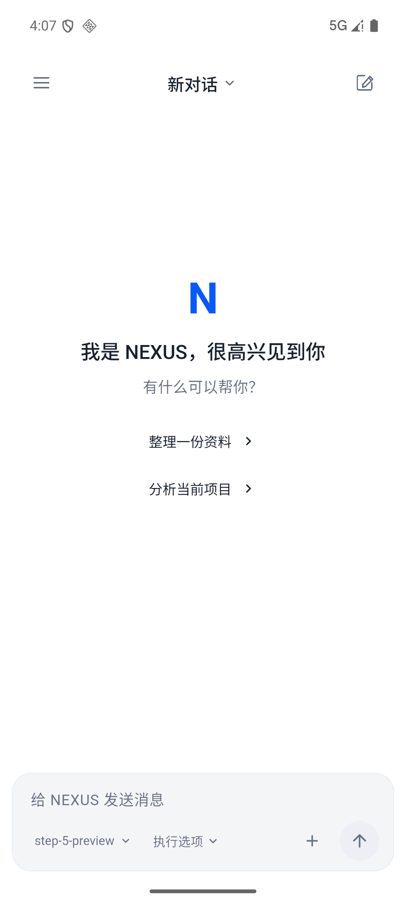

# NEXUS Agent

面向 **Android 与 Windows** 的多模型 AI Agent 工作台。当前源码版本：**0.9.0+95**。

[下载已发布版本](https://github.com/2014569061-png/ai-agent/releases) · [开发与构建](docs/getting-started.md) · [文档](docs/README.md) · [验证状态](docs/verification.md)

## 功能

- **多模型对话**：OpenAI 兼容接口、Anthropic、Gemini、托管代理，支持流式回复、上下文与用量查看。
- **Agent 执行**：多轮工具调用、计划确认、暂停与继续、风险审批、失败重试及运行记录。
- **项目工作区**：文件编辑、Git 改动、终端、网页预览与 ZIP 成果交付；Windows 提供多面板工作台。
- **工具扩展**：内置技能、MCP、Agent 配置、长期记忆、知识库与定时任务。
- **手机入口**：侧栏导航、应用快捷方式、小组件、后台待审批通知与可接管的临时浏览器。
- **本地数据**：Drift/SQLite 会话与任务记录，API Key 使用系统安全存储，提供保险箱备份和审计入口。

工具执行受实际权限和审批规则约束。终端逐次确认，工作目录不是完整文件系统沙箱；数据、费用和后台运行边界见[安全说明](docs/security.md)。

## Android 界面



Android 以对话和左侧抽屉为主，Windows 使用项目工作台。截图为 2026-10-24 的模拟器界面；实际功能以当前源码与设备条件为准。

## 运行源码

需要 Flutter **3.47.2**、Dart **3.13+**；Android 构建需要 JDK 17。Windows 还需要 Visual Studio C++ 桌面工作负载、Windows SDK 与 NuGet CLI。

```bash
git clone https://github.com/2014569061-png/ai-agent.git
cd ai-agent
flutter pub get
flutter run
```

首次启动后，在设置中配置模型接口、模型名称和自己的 API Key。SDK、模拟器和签名文件由本机准备，不随仓库提供。

| 目标 | 入口 |
|---|---|
| Windows 上预览 Android | android-preview.bat 或 tool/run-android-preview.ps1 |
| Android ARM64 构建 | build-apk.bat |
| Windows 打包 | tool/build-windows.ps1 |
| 自动化检查 | flutter analyze、flutter test 与 .github/workflows/ |

参数、签名、模拟器配置和平台差异见[开发与构建](docs/getting-started.md)。下载与更新以 [Releases](https://github.com/2014569061-png/ai-agent/releases) 的实际附件及 SHA-256 校验文件为准。

## 项目结构

```text
lib/           应用逻辑、领域模型、平台接入与界面
test/          自动化测试与夹具
assets/        字体、图片、内置技能与 ARM64 Linux 运行资源
shaders/       Flutter 着色器
android/       Android 原生工程
windows/       Windows 宿主与安装器
tool/          构建、预览、验收和质量门禁
docs/          当前使用与开发文档
architecture/  架构决策记录
.github/       CI 与发布工作流
```

内部交接、历史方案、本机日志、SDK、缓存和构建产物不纳入公开文件树。pubspec.lock、Gradle wrapper、测试、运行资源和第三方声明属于项目必要内容。

## 开发状态

最近一次本机全量测试为 **2,740 通过、69 失败**，另有定向复测 56 项通过；仍有 **64 项已知测试失败**。静态分析及静默异常门禁通过，手写代码覆盖率 **59.55%**。完整复现方法与失败清单见[验证状态](docs/verification.md)，远程结果见 [GitHub Actions](https://github.com/2014569061-png/ai-agent/actions)。

正式安装包仍需按目标设备完成 ARM64、后台恢复、无障碍与性能验收。当前源码公开不等同于正式发布验收通过。

第三方运行时来源与声明见 [THIRD_PARTY_NOTICES.md](THIRD_PARTY_NOTICES.md)，版本变化见 [CHANGELOG.md](CHANGELOG.md)。
